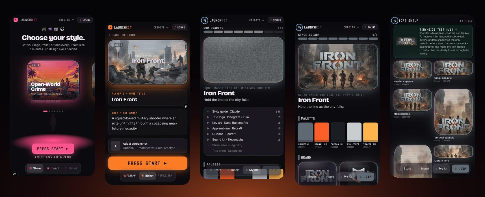
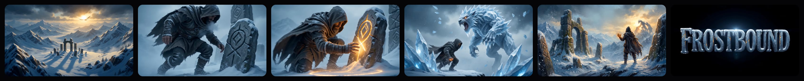
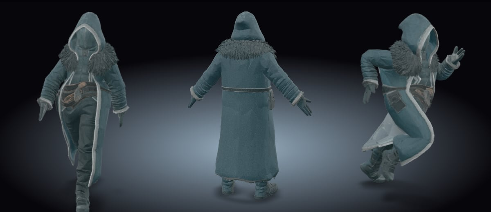

# 👾 Launch Kit



**Your game's storefront from a few taps.** Built for the Comfy hackathon on [Comfy Router](https://docs.comfy.org/development/comfy-router/quickstart): 9 models (Claude Sonnet 5.5, Ideogram 4.5, Bria Remove Background, Nano Banana Pro, Recraft V4.1 Vector, ElevenLabs SFX v2, Seedance 2.0 Fast, Meshy 7.1, Meshy Rigging), all through the [Comfy API](https://comfy.org/platform/comfy-api/).

🎮 **[Open the app →](https://launch-kit-beta.vercel.app)** (works best on a phone; access code: **PLAYER1**)

📹 **[See an example run, screen by screen →](docs/example-run/README.md)**

🧩 **[Get the ComfyUI nodes →](https://github.com/meshi6/comfyui-launch-kit)** (Style Guide, Store Capsules and Legibility Check, for your own workflows)

Walk into a digital game store, pick an aisle, type your game's name and pitch, press start. The art arrives in under a minute; about four minutes later, with both videos done, you have a consistent, ready-to-upload kit:

| Asset | Model (via Comfy Router) |
| --- | --- |
| 👑 Style guide: palette, art direction, store copy | `anthropic/claude-sonnet-5-5` |
| Title logo, cut out to a transparent PNG | `ideogram/ideogram-4-5` + `bria/image-edit-remove-background` |
| Key art (optionally matched to your screenshot) | `vertexai/gemini-3-pro-image` (Nano Banana Pro) |
| App emblem + 6 in-game UI icons (SVG) | `recraft/recraftv4_1_vector` |
| 🎧 Sound kit: title sting, menu select, level up | `elevenlabs/eleven_sfx_v2` |
| 📺 Every Steam capsule size, itch.io cover, app icon | composited on-device |
| Search-size legibility check (120×45) | `anthropic/claude-sonnet-5-5` (vision) |
| 📼 Animated title sting with audio | `byteplus/dreamina-seedance-2-0-fast-260128` |
| 🎥 12-second game trailer: multi-shot, music, narrator, ends on the logo | `byteplus/dreamina-seedance-2-0-fast-260128` |
| 3D hero: textured, rigged, with walking and running animations (.glb) | `meshy/meshy-7.1` + `meshy/rigging` |

🎥 Trailer for *Frostbound* (Fantasy RPG): *"What the cold buried, the blood remembers."*



3D hero for *Frostbound*: textured, rigged, walking and running, ready for Unity, Godot, Blender or Roblox Studio.



🔥 **The concept:** a single style guide generated first and fed into every model, so the logo, art, icons, sounds and video read as one game rather than nine AI outputs.

Then you download it as a `.zip`, laid out by platform.

## 🧑‍💻 Run it

```bash
npm install
# .env.local
COMFY_API_KEY=comfyui-...        # platform.comfy.org → API keys
LAUNCH_PASSCODE=choose-a-code     # optional: gates /api/* for public demos
npm run dev -- -H 0.0.0.0        # open on your phone on the same Wi-Fi
```

It's a mobile-first PWA (Next.js 16), so you can add it to your home screen. Append `?screen=insert` or `?screen=kit` to jump to a screen.

## Layout

- `src/app/api/*`: one route per model step (the API key never reaches the browser)
- `src/lib/useKit.ts`: client pipeline orchestration and video polling
- `src/lib/compose.ts`: canvas compositing for store sizes
- `src/components/Crt.tsx`: the CRT TV look

Steam requires AI-generated content to be disclosed in its content survey. Check Steamworks for the current capsule sizes before you ship.
