## 🎥 The trailers it makes

Every kit comes with a **12-second trailer**: several shots, trailer music, a narrator line written for the game, and the title logo at the end. Two examples from different aisles:

**Frostbound** (Fantasy RPG): *"What the cold buried, the blood remembers."*

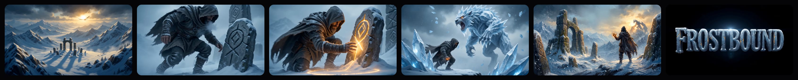

**Sunset Syndicate** (Open-World Crime): *"In this city, family is the only getaway."*

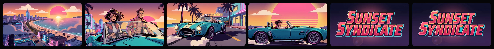

<sub>Seedance 2.0 Fast, about 2–3 minutes, using each kit's key art and logo as references, so every trailer follows its own style guide. See one play in the <a href="https://launch-kit-beta.vercel.app/?demo=1&play=1">auto demo</a>.</sub>

---

<div align="center">

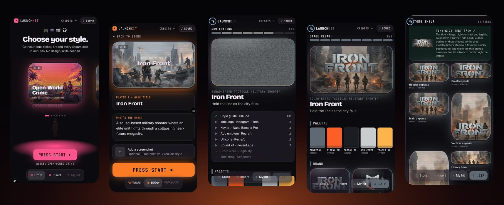

# Example run: *Iron Front*

**A few taps in, a full storefront out, on a phone.**<br>
Recorded live on the deployed app, November 2, 2026. Nothing below was edited.

| ⏱ Start → stage clear | 🖼 Store images | 🎨 UI icons | 🔊 Sounds | 🎬 Video | 🔎 Tiny-size test |
| :---: | :---: | :---: | :---: | :---: | :---: |
| **~3 min** | **10** | **6** | **3** | **5 s** | **8 / 10** |

</div>

---

## 1 · Pick an aisle

You walk into the store and swipe through TVs, one per genre. The floor light and colors change with each aisle.

<table>
<tr>
<td width="50%" align="center">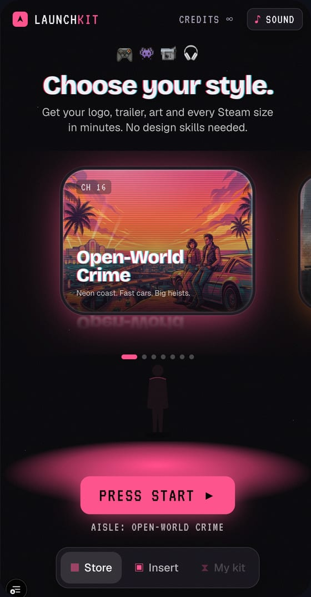<br><sub><b>Open-World Crime</b>, first aisle</sub></td>
<td width="50%" align="center">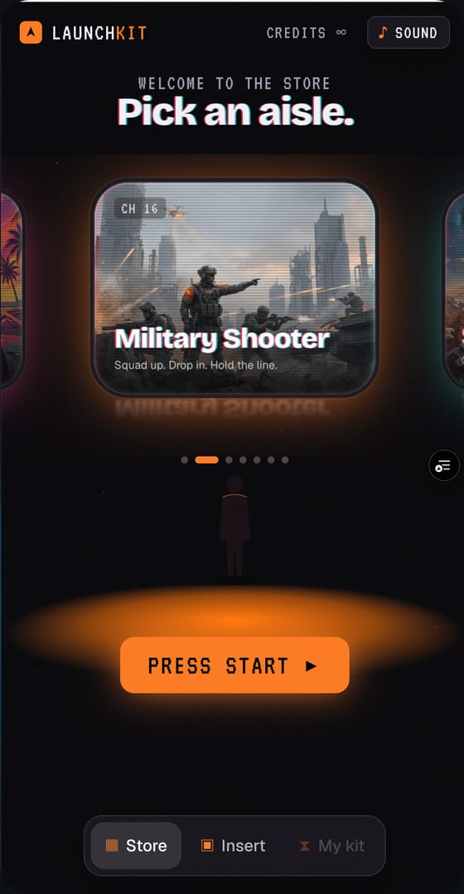<br><sub><b>Military Shooter</b>, the one we picked</sub></td>
</tr>
</table>

## 2 · Insert your game

The aisle pre-fills an example game. We kept it: *Iron Front*, "a squad-based military shooter where an elite unit fights through a collapsing near-future megacity." The public demo asks for an access code once, so strangers can't spend credits.

<table>
<tr>
<td width="33%" align="center">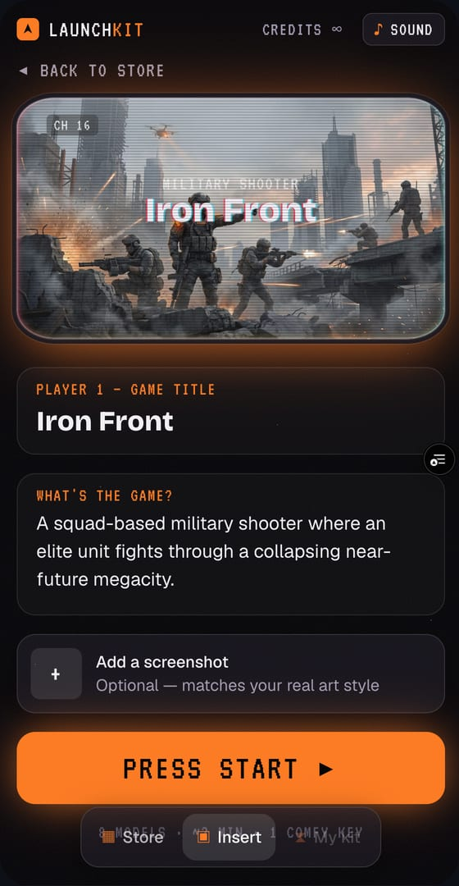<br><sub>Title and one-line pitch</sub></td>
<td width="33%" align="center">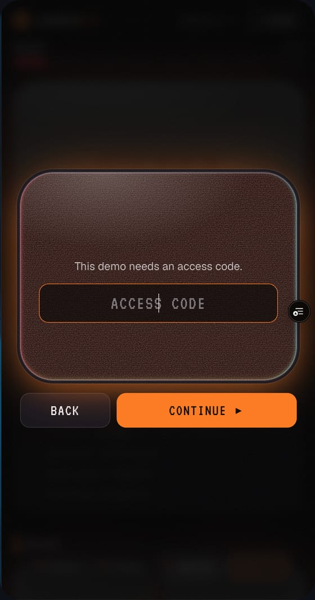<br><sub>"Insert coin"</sub></td>
<td width="33%" align="center">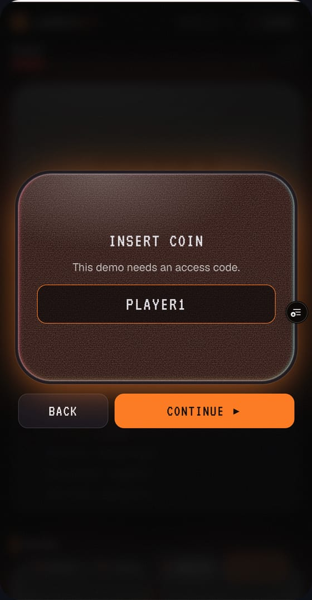<br><sub>Access code entered</sub></td>
</tr>
</table>

## 3 · Now loading

Claude writes one style guide first. Then the logo, key art, emblem, icons and sounds generate in parallel, and each TV switches on as its piece arrives.

<table>
<tr>
<td width="33%" align="center">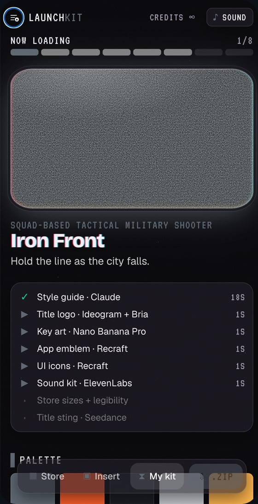<br><sub>Style guide done in <b>18 s</b></sub></td>
<td width="33%" align="center">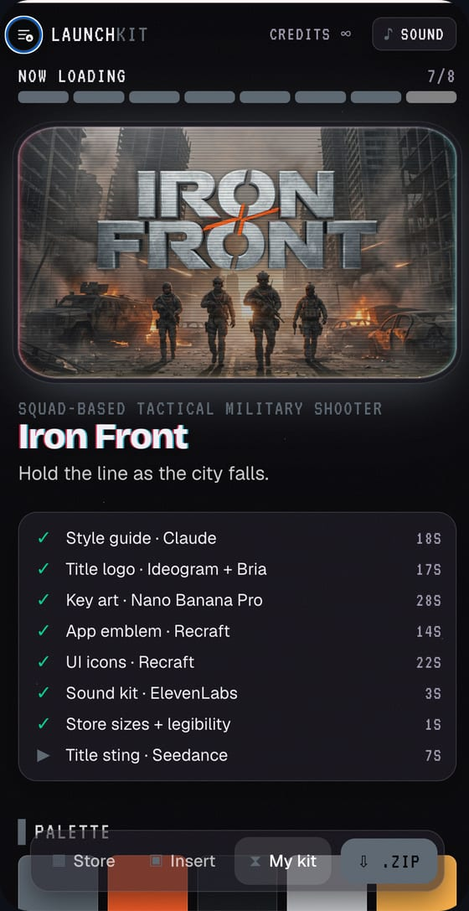<br><sub>Key art in at <b>28 s</b>, 7 of 8 steps done</sub></td>
<td width="33%" align="center">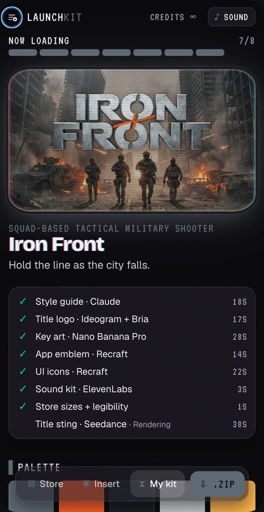<br><sub>Title sting video rendering</sub></td>
</tr>
</table>

| Step | Model | Time |
| --- | --- | ---: |
| Style guide | Claude Sonnet 5.5 | 18 s |
| Title logo + cut-out | Ideogram 4.5 + Bria Remove Background | 17 s |
| Key art | Nano Banana Pro | 28 s |
| App emblem | Recraft V4.1 Vector | 14 s |
| 6 UI icons | Recraft V4.1 Vector | 22 s |
| 3 sound effects | ElevenLabs SFX v2 | 3 s |
| 10 store sizes + tiny-size test | on the phone + Claude Sonnet 5.5 | 1 s + a few s |
| Title sting video | Seedance 2.0 Fast | ~1–2 min |

## 4 · Stage clear: the kit

Everything shares one palette (gunmetal, signal orange, carbon black, ash concrete, tracer amber), so it reads as one game rather than seven different AI outputs.

<table>
<tr>
<td width="50%" align="center">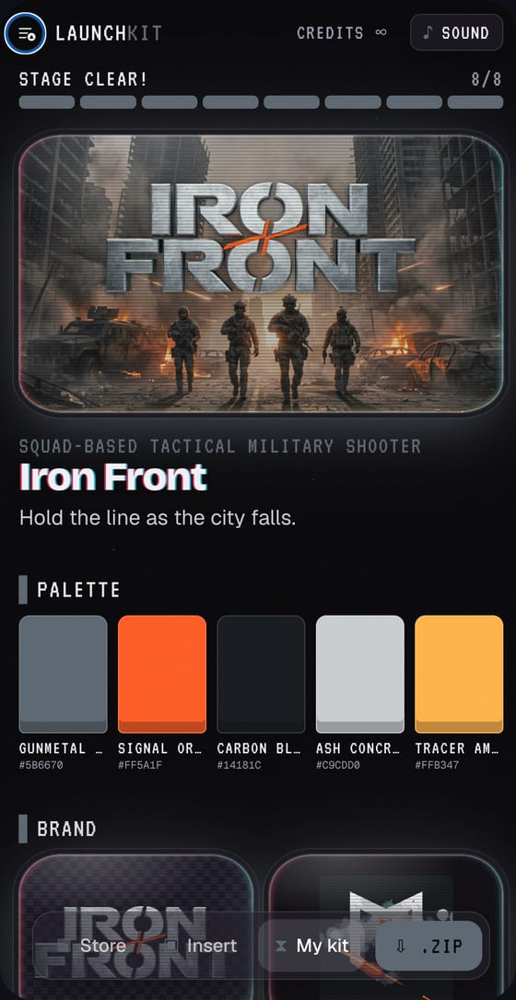<br><sub>Main capsule, tagline and palette</sub></td>
<td width="50%" align="center">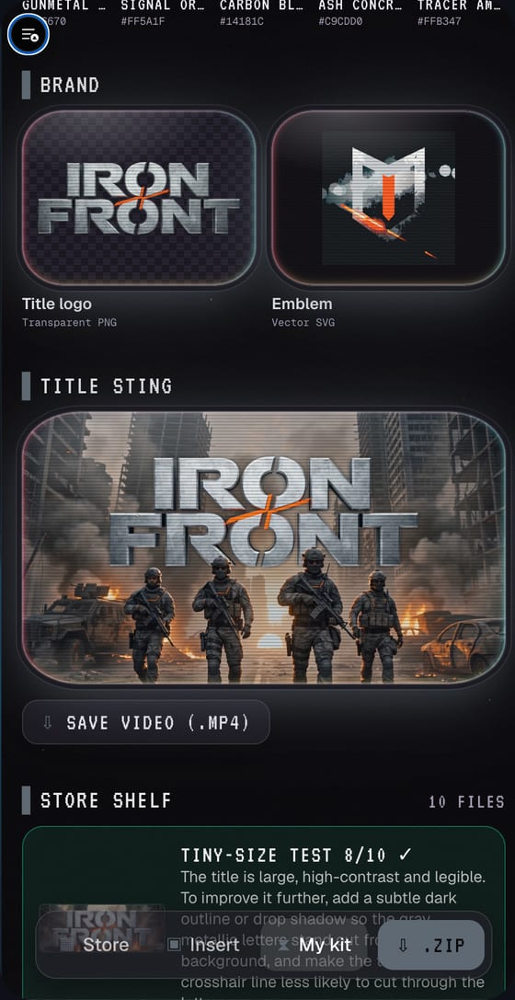<br><sub>Title logo, emblem and the animated title sting</sub></td>
</tr>
<tr>
<td width="50%" align="center">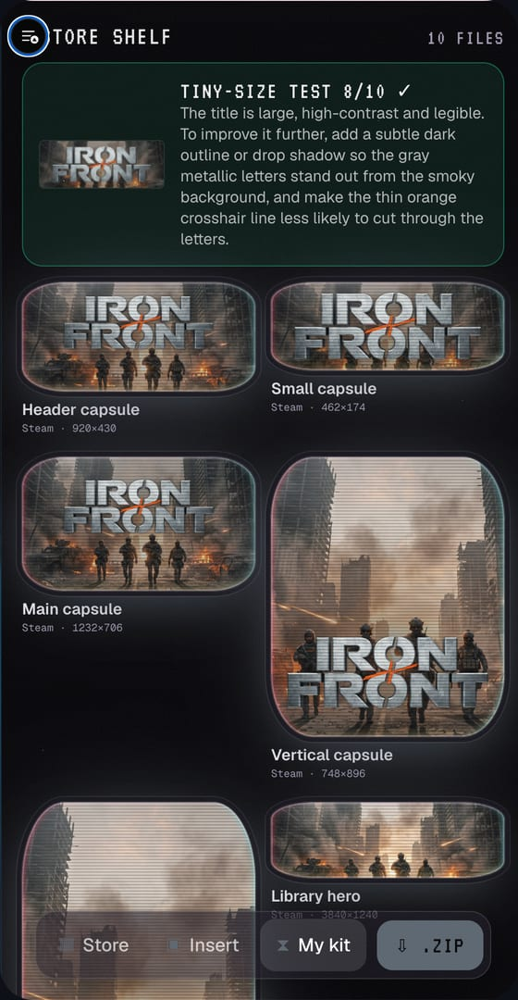<br><sub>Steam sizes, plus the tiny-size test: <b>8/10</b> with a fix tip</sub></td>
<td width="50%" align="center">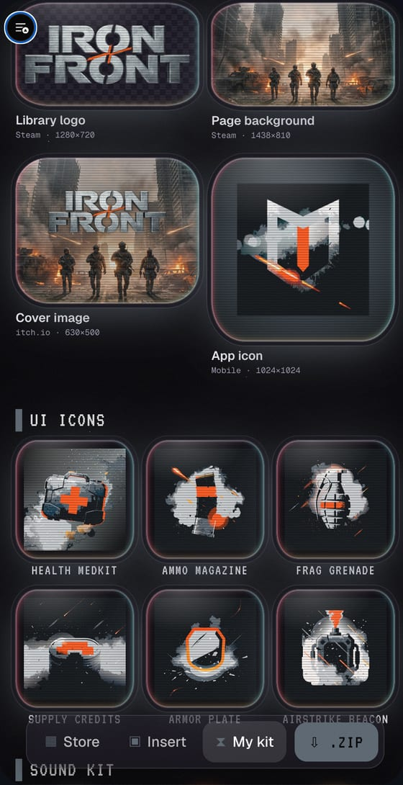<br><sub>Library logo, itch.io cover, app icon, UI icons</sub></td>
</tr>
<tr>
<td width="50%" align="center">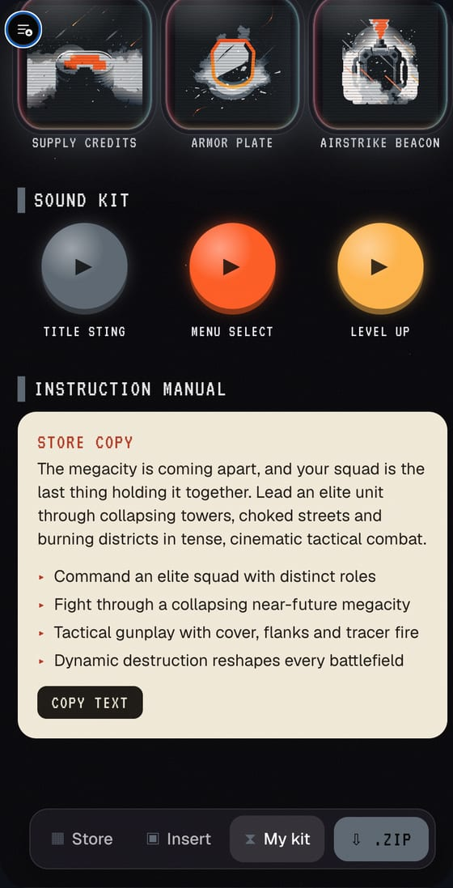<br><sub>Sound kit (arcade buttons) and store copy, ready to paste</sub></td>
<td width="50%" valign="middle">

**Then one tap on ⇩ .zip** downloads everything, sorted by platform:

```
iron-front-launch-kit/
├── README.md          style guide + store copy
├── style-guide.json
├── brand/             title-logo.png · emblem.svg · key-art.jpg
├── store/
│   ├── steam/         8 sizes
│   ├── itch-io/       cover
│   └── mobile/        app icon
├── ui-icons/          6 × .svg
└── audio/             3 × .mp3
```

</td>
</tr>
</table>

---

<div align="center">

**Try it yourself** · [Live app](https://launch-kit-beta.vercel.app) (access code PLAYER1) · [Stage-safe demo](https://launch-kit-beta.vercel.app/?demo=1) · [Back to the project](../../README.md)

</div>
